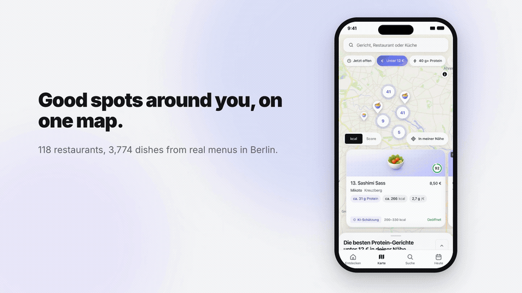
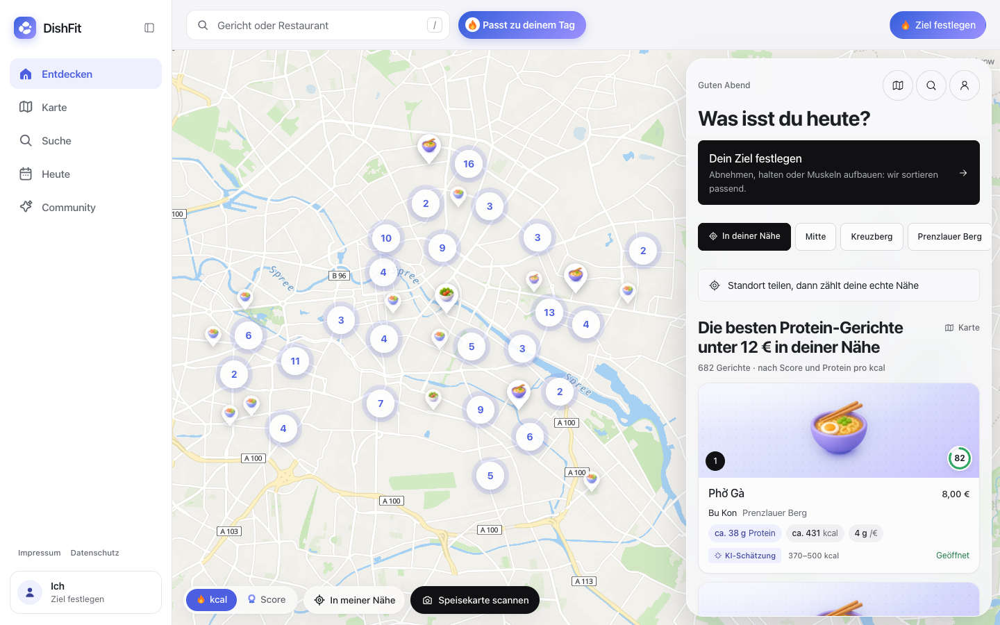
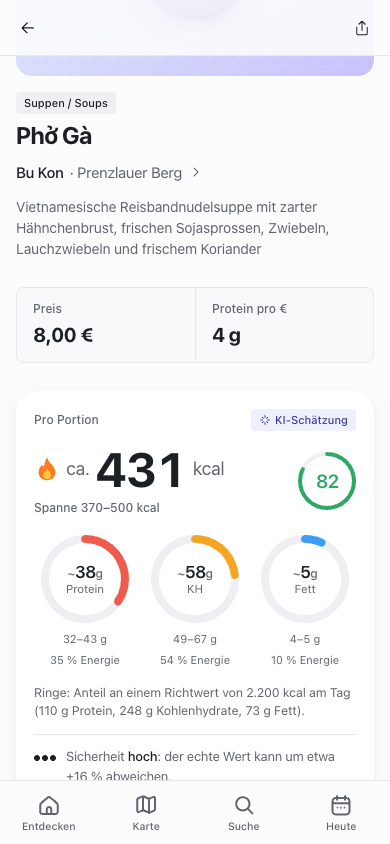
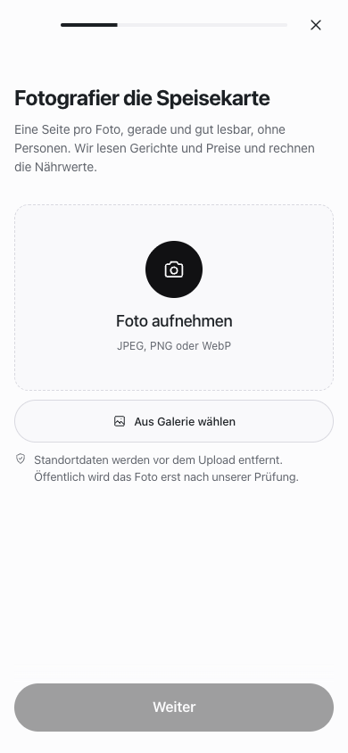
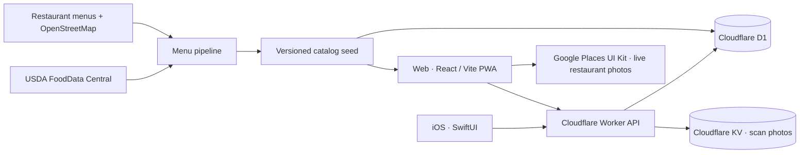

# DishFit

**Find a healthy dish you can order nearby in Berlin, with the menu price, calories and macros before you sit down.**

[Open DishFit](https://dishfit.caniberk.dev/) · [Watch the 60-second demo](docs/readme/dishfit-demo.mp4) · [View the hackathon pitch deck](submission/slides.pdf) · [Run locally](#quickstart)

[](docs/readme/dishfit-demo.mp4)

## Why DishFit

A calorie tracker helps you log a meal. A delivery app helps you find somewhere to order from. DishFit helps you decide **which specific dish near you fits your budget and goals**. Every result ties a menu item to its restaurant. You can filter by neighborhood, price, calories, protein or opening hours before opening the dish and seeing how the numbers were estimated.

The 22 November 2026 live snapshot counted **4,823 published dishes at 309 restaurants across 15 Berlin neighborhoods**. The restaurant endpoint supplies the dish totals and the Kiez endpoint confirms where restaurants are live. All 309 restaurants had a Google Place ID, and the photo audit found at least one Google photo for each. Photos showed the restaurant where available through Google Places UI Kit with attribution; Places is now off by default and cards use labeled illustrations. Dish illustrations are labeled **KI-Bild**. [Live restaurant and dish counts](https://dishfit.caniberk.dev/api/restaurants) · [Neighborhood counts](https://dishfit.caniberk.dev/api/kieze) · [Photo audit](docs/data/photo-coverage.md)

A full meal passes our discovery rule at **750 kcal or less, 20 g protein or more, and at least 15% of its calories from protein**. Starters, sides and soups have a 500 kcal cap. The rule excludes categories such as pizza, burgers and desserts, plus dishes flagged as fried, creamy or sugary. Discovery requires two qualifying dishes per restaurant. [Healthy rule](packages/contract/src/dish-class.ts)

## How it works

1. **Explore the map.** Share your location or pick a Kiez. Narrow the list by budget, protein, calories or what is open. [Open the Berlin map](https://dishfit.caniberk.dev/map)
2. **Check the exact dish.** See the price, calories, protein, carbs and fat, plus the source and a range for estimated values. For example, Bu Kon's Phở Gà was listed at **€8 and about 38 g protein** when we captured the live app. [Open the dish](https://dishfit.caniberk.dev/d/d_d90ad7bf00ae3d98)
3. **See how it fits your day.** Set a goal, use **Passt zu deinem Tag** to get suggestions, then add a dish to your **Heute** diary. [Open the diary](https://dishfit.caniberk.dev/today)
4. **Scan a menu or help verify one.** Photograph a menu for a reading or submit it to the community review queue. Confirm an existing dish or suggest a correction through **Hat das gestimmt?**. [Open the community scan](https://dishfit.caniberk.dev/scan) · [Open the community page](https://dishfit.caniberk.dev/me)

[](https://dishfit.caniberk.dev/)

Map data © [OpenStreetMap contributors](https://www.openstreetmap.org/copyright) under ODbL. Tiles by [OpenFreeMap](https://openfreemap.org/) and © [OpenMapTiles](https://openmaptiles.org/).

| Dish detail on mobile | Community menu scan on mobile |
| --- | --- |
|  |  |

## Demo, pitch and iOS

- **Product walkthrough (60 seconds)** follows the map, dish details, daily goals and a menu scan. [Widescreen MP4](docs/readme/dishfit-demo.mp4) · [Vertical MP4](docs/readme/dishfit-demo-vertical.mp4)
- **Hackathon pitch** covers the problem, the data pipeline and the launch plan. [Pitch deck PDF](submission/slides.pdf) · [Deck source](submission/)
- **Native iOS app** brings discovery, the diary and camera menu scanning to SwiftUI. [Xcode setup](apps/ios/README.md) · [App icon reveal MP4](docs/readme/dishfit-logo-reveal.mp4)

The demos were recorded during the build. The catalog figures above are from the live deployment. [Workers.dev fallback](https://wohin.batubln.workers.dev/)

## Quickstart

From a fresh clone, use Node.js 22.18 or newer. These two commands start the web app with the bundled catalog and require no API keys.

```sh
npm ci --prefix apps/web
npm run dev --prefix apps/web
```

Open [localhost:5173](http://localhost:5173/). The diary, discovery and dish details work with the bundled catalog. Start the Worker for scan and community API calls.

<details>
<summary>Run the local Worker and project checks</summary>

Run these commands from the repository root in a second terminal.

```sh
npm ci
cp worker/.dev.vars.example worker/.dev.vars
npm run db:migrate:local
npm run db:seed:local
npm run dev
```

Vite proxies `/api` to the Worker on port 8787. The local Worker seed contains test restaurants. Set `SCAN_AI_MODE=mock` in `worker/.dev.vars` for sample camera scan results. The [deployment guide](docs/deploy.md) covers real data, Google Places and environment configuration.

```sh
npm run deploy:check
npm run lint --prefix apps/web
npm test --prefix apps/web
npm ci --prefix pipeline && npm run check --prefix pipeline
```

The deploy check builds the web app, renders share cards, runs lint, type checks and unit tests, generates the seed and dry-runs the Worker bundle. Playwright runs 17 journeys at both desktop and phone widths, including discovery, scans, community contributions and offline use. Run `npx playwright install chromium` once, then `npm run e2e`. [Playwright configuration](e2e/playwright.config.ts) · [Local test server](e2e/serve.ts)

</details>

## Architecture



The TypeScript pipeline estimates portions and computes nutrition from ingredient data. It uses official restaurant values where available. A shared TypeScript contract holds the catalog types and healthy rule. [Pipeline](pipeline/) · [Shared contract](packages/contract/) · [Worker](worker/) · [Web](apps/web/) · [iOS](apps/ios/)

## Credits

- **Restaurant and map data** from © OpenStreetMap contributors under ODbL, with OpenFreeMap tiles, OpenMapTiles and MapLibre GL JS (BSD-3-Clause). [OpenStreetMap](https://www.openstreetmap.org/copyright) · [OpenFreeMap](https://openfreemap.org/) · [MapLibre license](https://github.com/maplibre/maplibre-gl-js/blob/main/LICENSE.txt)
- **Restaurant photos and place details** from Google Places UI Kit under Google Maps Platform terms, only when a build opts in (off by default; the app then shows its own content). DishFit stores the place ID and the UI Kit loads the attributed content live. [Places UI Kit](https://developers.google.com/maps/documentation/javascript/places-ui-kit/overview)
- **Ingredient nutrition** from USDA FoodData Central SR Legacy data (public domain, CC0). [USDA data documentation](https://fdc.nal.usda.gov/data-documentation/) · [Pipeline ingredient data](pipeline/README.md#nutrition-method)
- **Typography and icons** use system fonts and SF Symbols on Apple platforms, Inter (SIL Open Font License 1.1) on the web, and the project's own brand icons. [Inter license](https://github.com/rsms/inter/blob/master/LICENSE.txt) · [SF Symbols terms](https://developer.apple.com/sf-symbols/) · [Brand assets](brand/)

## Team

Batu, Malek Hassan, Vinay Naik and Kalvarez09 built DishFit for the Layla × Expedia Group 5K Build & Launch hackathon in Berlin. [Team workstreams](docs/team-prompts/) · [Earlier Plus One project](archive/plus-one/)

## Contributing

Keep the existing UI and design fixed and focus contributions on features, bugs, data, tests or docs, with design changes agreed with Batu first. [Agent guidance](AGENTS.md)
