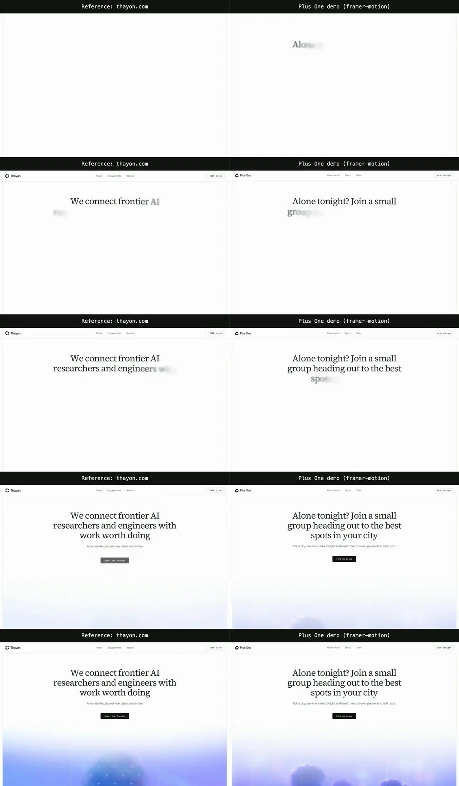

# Plus One motion spec

This is the motion system for Plus One, copied 1:1 in timing and feel from the reference landing page at [thayon.com](https://thayon.com/).
Only the motion is reused.
Every text, image and mark in the implementations is Plus One's own.

- Tokens: [motion.json](motion.json) is the single source of truth.
- Web: [web/](web/) has a framer-motion variant, a GSAP variant and a runnable demo page.
- iOS: [ios/Motion.swift](ios/Motion.swift) has matching `Animation` values and view modifiers.
- Reference frames for internal comparison: [frames/](frames/).

## How it was measured

The reference was captured live on 21 November 2026 at 1440 × 900 CSS px in headless Chrome 157, in a dedicated chrome-devtools-axi session.
Four independent sources agree on every value below.

1. A recorder injected before any page script wrapped `Element.prototype.animate`, so every Web Animations API call was logged with its keyframes, duration, delay and easing.
2. The same recorder sampled every element's inline `style` once per frame, which captures the JS-driven springs that never reach WAAPI.
3. `document.getAnimations()` was polled each frame for CSS animations and transitions.
4. The shipped Framer bundles were read for the authored configs (Framer appear JSON, effect variants, the Lenis 1.0.29 options and the button and magnetic-hover components).

Screencast frames were recorded at known scroll positions with a scripted wheel (90 steps of 100 px every 130 ms after a 4.2 s settle) and a scripted pointer path.
The reference uses Framer's motion runtime and Lenis.
It does not use GSAP, a custom cursor, a marquee or scroll-linked image parallax.
The repeated lab names in the markup are breakpoint duplicates, not a ticker.

## Springs

The reference authors springs in framer-motion's duration-based form (`type: "spring", duration, bounce`).
We solved each one to physical stiffness and damping (mass 1) with framer-motion's own root finder and then replayed the closed-form curve against the `linear()` easings Chrome exposed.
The largest deviation is 0.0003 for `appear` and 0.001 for `text` and `textQuick`, in units of progress.

| Token | Framer config | Stiffness / damping | Overshoot | Closest cubic-bezier (RMSE) | Used for |
| --- | --- | --- | --- | --- | --- |
| `appear` | 1 s, bounce 0.2 | 80.9 / 14.39 | 1.52 % | (0.326, 0.674, 0.053, 1.132), 0.013 | Fade-and-slide reveals |
| `text` | 0.5 s, bounce 0 | 341.02 / 36.93 | none | (0.253, 0.416, 0.087, 1.076), 0.008 | Headline characters |
| `textQuick` | 0.4 s, bounce 0 | 532.85 / 46.17 | none | (0.253, 0.416, 0.087, 1.076), 0.008 | Section heading and label characters |
| `nav` | 2 s, bounce 0.2 | 20.22 / 7.2 | 1.52 % | (0.326, 0.674, 0.053, 1.132), 0.013 | Header drop-in |
| `zoom` | 3 s, bounce 0.2 | 8.99 / 4.8 | 1.52 % | (0.326, 0.674, 0.053, 1.132), 0.013 | Closing call-to-action backdrop |
| `state` | 0.4 s, bounce 0.2 | 505.61 / 35.98 | 1.52 % | (0.326, 0.674, 0.053, 1.132), 0.013 | Component state changes |
| `magnetic` | stiffness 440, damping 100 | 440 / 100 | none, overdamped | not a timed curve | Pointer follow |
| `scrollRotate` | stiffness 500, damping 60 | 500 / 60 | none, overdamped | not a timed curve | Logo rotation smoothing |

A duration-based spring with the same bounce has the same shape at every duration, which is why several rows share one cubic-bezier.
Use the spring where the platform has one (framer-motion, SwiftUI), the `linear()` string in [motion.json](motion.json) for CSS, and the cubic-bezier only as a last resort.

The timed curves are:

| Token | Duration | Curve | Used for |
| --- | --- | --- | --- |
| `roll` | 300 ms per character, 500 ms per row | cubic-bezier(0.25, 0.74, 0.22, 0.99) | Rolling button label |
| `press` | 200 ms | cubic-bezier(0, 0, 0.58, 1) | Button hover and press scale |
| `smoothScroll` | 1000 ms | `t => min(1, 1.001 - 2^(-10t))`, approx. cubic-bezier(0.149, 0.994, 0.312, 0.999) | Lenis wheel smoothing |

## Animation catalogue

Times are from first paint.
"Hidden" opacity is 0.001 for text and the hero art, which keeps elements paintable for the compositor, and 0 elsewhere.

### 1. Header drop-in

- Trigger: on mount.
- Properties: `opacity` 0 → 1, `translateY` -80 px → 0.
- Timing: `nav` spring, no delay.
- Measured: settles about 1.45 s after hydration, with the 1.52 % overshoot visible as a sub-pixel dip.

### 2. Display headline, per character

- Trigger: on mount (hero), or entering view with amount 0 elsewhere.
- Split: one inline-block span per character, words kept unbreakable, spaces not counted in the stagger.
- Properties: `opacity` 0.001 → 1, `filter` blur(10px) → blur(0), `translateY` 10 px → 0.
- Timing: `text` spring (500 ms), stagger 25 ms, start 0.
- Measured: 60 characters, delays 0 → 1475 ms, so the last character lands at about 1.98 s.

### 3. Hero supporting line and action

- Trigger: on mount.
- Properties: `opacity` 0 → 1, `translateY` 30 px → 0.
- Timing: `appear` spring, supporting line at 1500 ms, action at 1700 ms.

### 4. Hero art and overlay

- Trigger: on mount.
- Properties: `opacity` 0.001 → 1, `translateY` 90 px → 0.
- Timing: `appear` spring at 2000 ms, for both the image frame and the registration overlay above it.
- The overlay also carries the magnetic hover (11).

### 5. Strip below the hero

- Trigger: on mount.
- Properties and spring as 4, at 2200 ms.
- On phones the following sections join the same chain at 2400, 2600 and 2800 ms.

### 6. Section content, fade and slide

- Trigger: entering view, once.
- Amount: 0.5 for paired columns and headings, 0 for blocks that start near the fold.
- Properties: `opacity` 0 → 1 and one of `translateY` 30 px, `translateY` 20 px, `translateY` 60 px, `translateX` -10 px (left column) or `translateX` +10 px (right column) → 0.
- Timing: `appear` spring with delays from the sequence 0, 200, 300, 400, 500, 900, 1000, 1100, 1200, 1300, 1400, 1450, 1500, 1600 ms.
- Measured: each block settles about 1.0 s after it starts, at the scroll position where its threshold is crossed.

### 7. Eyebrow labels, replaying

- Trigger: entering view with amount 0.5, not once, so it animates back out on exit and in again on re-entry.
- Properties: `opacity` 0 → 1, `translateY` 10 px → 0.
- Timing: `appear` spring with a 300 ms delay, both in and out.

### 8. Section headings, per character

- Same split and properties as 2.
- Variants found on the page: `text` with a 25 ms stagger (long feature headings), and `textQuick` with stagger 15 ms after a 200 ms start, 20 ms after a 1500 ms start, or 50 ms.
- Measured: a 118-character feature heading ran delays 0 → 2875 ms at 25 ms per character, and a 23-character heading ran 200 → 530 ms at 15 ms.

### 9. Rolling button label

- Trigger: pointer enter and leave (and focus in our implementation).
- Structure: two stacked rows of characters in a 1.2 em tall clipped box.
- Outgoing row: `translateY` 0 → -110 %, 500 ms `roll`; each character `opacity` 1 → 0 and `translateY` 0 → -10 px, 300 ms `roll`, stagger 30 ms.
- Incoming row: `translateY` 110 % → 0, 500 ms `roll`; each character `opacity` 0 → 1 and `translateY` 10 px → 0, 300 ms `roll`, stagger 30 ms.
- Leaving runs the same tweens back with the same stagger.
- Button: `scale` 1 → 0.98 over 200 ms `press`, measured settle at 217 ms; also 0.98 on press.

### 10. Component state changes

- Nav items and menu toggles switch variants on the `state` spring.
- This value comes from the shipped component code and was not separately frame-captured.

### 11. Magnetic hover

- Trigger: pointer moves within the element's box grown by 49 px on every side; desktop pointers only, static under touch.
- Input: pointer offset from the element centre, divided by its half-width and half-height.
- Properties: the element translates by input × 24 px, and its inner layers by a further input × 10 px, which gives the depth effect over the hero art.
- Timing: `magnetic` spring (stiffness 440, damping 100), returning to 0 when the pointer leaves.
- Used on the hero overlay and the closing call-to-action card.

### 12. Logo symbol, scroll rotation

- Trigger: page scroll.
- Properties: `rotate` = scrollY × 0.5 deg, smoothed by the `scrollRotate` spring.
- Measured: 0.496 to 0.534 deg per px across a 9000 px scroll, ending at 4718.5 deg, about 13 full turns, with a short lag after the scroll stops.

### 13. Sticky horizontal track

- Trigger: scroll through a tall section with a sticky, full-height stage.
- Properties: track `translateX` 0 → -(track width − viewport width), linear in scroll progress.
- Measured: 0.894 px of horizontal travel per px scrolled, -3400 px over the 3800 px section.
- Our implementations size the section as viewport height + travel ÷ 0.894, so the ratio holds for any number of cards.
- Phones stack the cards instead.

### 14. Closing call-to-action backdrop

- Trigger: entering view, amount 0, once.
- Properties: `opacity` 0 → 1, `scale` 2.5 → 1.
- Timing: `zoom` spring (3 s).
- Measured: still at scale 2.499 one frame in and settled about 3.0 s later.
- The card above it reveals with 6 (`translateY` 20 px) and carries 11.

### 15. Footer curtain

- The footer is `position: fixed` behind the page, and the page ends with a spacer of the footer's height.
- Scrolling the last section away uncovers the footer in place; no timed animation is involved.

### 16. Smooth scroll

- Lenis 1.0.29 with `duration: 1` (intensity 10 ÷ 10) and its default expo-out easing; wheel input only, touch stays native.
- Programmatic `scrollTo` calls through Lenis use the same duration and easing.
- There are no page or route transitions; the site is a single page.

### Reduced motion

The reference ignores `prefers-reduced-motion` for its appear effects.
Plus One does not: with reduced motion on, both web variants and the SwiftUI modifiers render final states immediately and skip transforms, blur, smooth scrolling, magnetic follow, rolling labels and scroll rotation.

## Reference frames

Each strip shows the same moments of the same scripted session, reference on the left and the Plus One demo on the right.
They are internal comparison material and must not ship in the product.

| Strip | Moments |
| --- | --- |
| [Intro](frames/intro.webp) | 0.35, 0.9, 1.5, 2.3 and 3.3 s after load |
| [Reveals](frames/reveals.webp) | Dark band and feature heading entering view |
| [Sticky track](frames/track.webp) | Four points along the horizontal travel |
| [Closing call to action](frames/cta.webp) | Backdrop zoom from 2.5× and the footer curtain |
| [Hover](frames/hover.webp) | Before hover, mid-roll, rolled, rolling back, and the magnetic overlay |

## Using the implementations

### Web

Run the demo from `docs/design/motion/web` with `npm install` and `npm run dev`, then open http://localhost:5178/ for the framer-motion variant or http://localhost:5178/?variant=gsap for the GSAP variant.
Both variants read [motion.json](motion.json) through `src/motion/tokens.ts`.

| Effect | framer-motion (`src/motion/framer.tsx`) | GSAP (`src/motion/gsap.ts`) |
| --- | --- | --- |
| 1 | `<NavDrop>` | `navDrop(el)` or `data-motion="nav"` |
| 2, 8 | `<CharReveal text trigger startDelay stagger spring>` | `charReveal(el, opts)` or `data-motion="chars"` |
| 3 to 7 | `<Reveal x y scale delay spring trigger amount once>` | `reveal(el, opts)` or `data-motion="reveal"` |
| 9 | `<RollButton label href>` | `rollButton(el)` or `data-motion="roll"` |
| 11 | `<Magnetic>` with `<MagneticLayer>` | `magnetic(el)` or `data-motion="magnetic"` with `data-magnetic-layer` |
| 12 | `<ScrollRotate>` | `scrollRotate(el)` or `data-motion="rotate"` |
| 13 | `<StickyTrack>` | `stickyTrack(section, track)` or `data-motion="track"` |
| 14 | `<ZoomIn>` | `zoomIn(el)` or `data-motion="zoom"` |
| 15 | `<CurtainFooter>` | `curtainFooter(el)` or `data-motion="curtain"` |
| 16 | `useSmoothScroll()` | `smoothScroll()`, also started by `initMotion()` |

The framer-motion variant hands springs to framer-motion as `duration` and `bounce`, so it runs the reference's own solver.
The GSAP variant passes the closed-form spring as the ease, so a 1 s GSAP tween with `springEase(spring.appear)` follows the same curve.
The curtain footer needs the page content above it on an opaque background with a higher stacking order, as in `demo.css`.

### iOS

Drop [ios/Motion.swift](ios/Motion.swift) into the app target.
It needs iOS 17, and uses `TextRenderer` for the per-character reveal on iOS 18 with a whole-line fallback before that.

| Effect | SwiftUI |
| --- | --- |
| Springs and curves | `PlusMotion.appear.animation`, `.text`, `.textQuick`, `.nav`, `.zoom`, `.state`, `.magnetic`, `.scrollRotate`, `PlusMotion.rollChar`, `.rollRow`, `.press` |
| 1 | `.plusNavDrop()` |
| 2, 8 | `PlusCharReveal("…", startDelay:, stagger:, spring:)` |
| 3 to 6 | `.plusReveal(x:y:scale:delay:spring:trigger:)` with `.appear` or `.inView(threshold:once:)` |
| 7 | `.plusLabelReveal()` |
| 9 | `PlusRollButton("…") { }` or `PlusRollingText("…", active:)` in your own button |
| 11 | `.plusMagnetic()`, pointer only |
| 12 | `.plusScrollRotate(offset:)` fed from `onScrollGeometryChange` |
| 14 | `.plusZoomIn()` |

`interpolatingSpring(mass: 1, stiffness:, damping:)` is used instead of `.spring(duration:bounce:)` because SwiftUI's duration means perceptual duration, not framer-motion's settling duration.
The per-character renderer counts spaces as glyphs, so a long iOS headline finishes about one stagger step per space later than the web one.
The sticky horizontal track has no SwiftUI modifier, because the reference stacks those cards on phones; use a vertical stack with 6.
